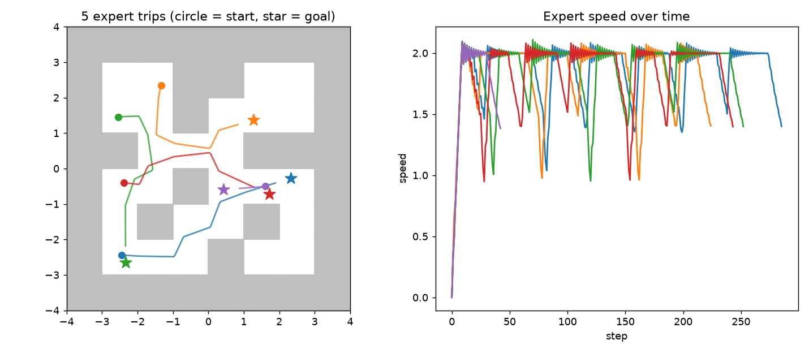
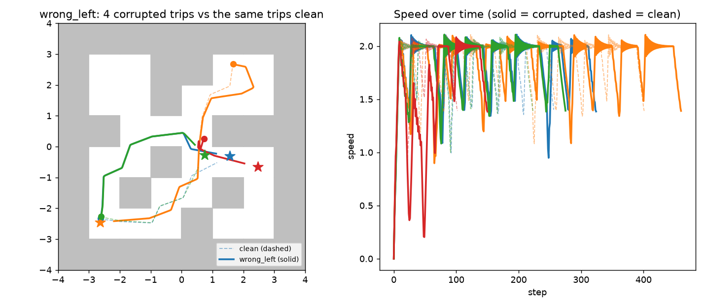
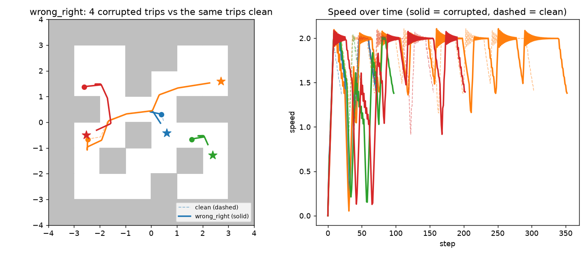
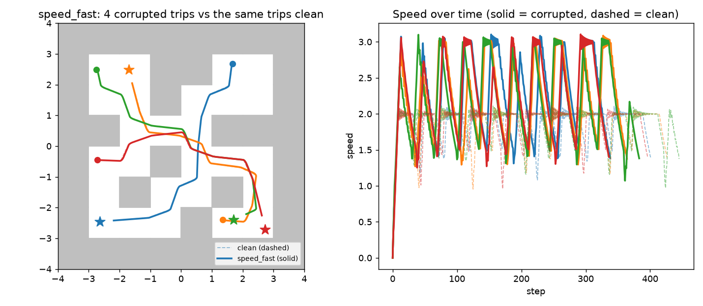
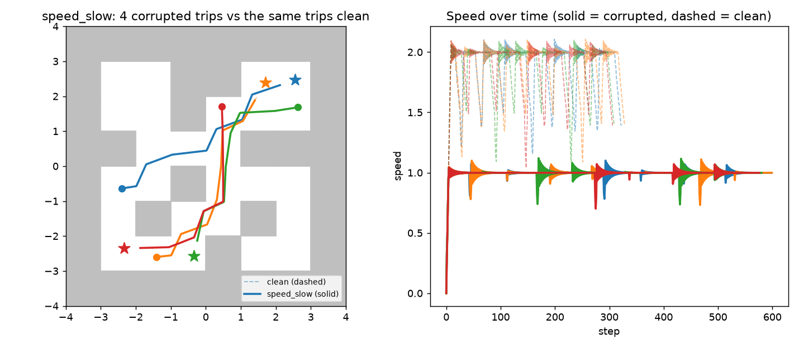

# Impact of Demonstration Error Types on Imitation Learning (PointMaze)

CS59300 ILR course project. The question: which kinds of mistakes in demonstration data hurt a behavior
cloning navigation policy the most, and do combinations of mistakes hurt more than the sum of their parts?

## Project status

| Part | What | File | State |
| --- | --- | --- | --- |
| Environment | PointMaze installs and the expert reaches the goal | `src/check_env.py` | done |
| Expert data | 500 clean expert trips | `src/make_expert_data.py` | done |
| Data plots | Expert trips drawn on the maze | `src/plot_trajectories.py` | done |
| Training | Behavior cloning policy | `src/train_bc.py` | done |
| Evaluation | Four metrics on 200 fixed test trips | `src/evaluate.py` | done |
| Corruptions | Wrong left turn, wrong right turn, speed error | `src/corrupt.py` | done |
| Corruptions | Delayed turn, obstacle mistake, missing recovery | `src/corrupt.py` | next |
| Combinations | Pairs of errors and a mixed dataset | | planned |
| Diagnosis | Classifier that guesses the error type from rollouts | | planned |

## Results so far (October 21, 2026)

Three seeds per dataset, 200 fixed test trips (`TEST_SEED = 12345`), mean ± standard deviation across
seeds. In every corrupted dataset, 20% of the 500 training trips contain the error, and they are the
same 100 trips for every error type.

| Policy | Success | Collisions | Path efficiency | Time to goal (steps) |
| --- | --- | --- | --- | --- |
| Expert driver (upper bound) | 100% | 0% | 1.000 | 211 |
| BC, clean data | 89.7 ± 2.8% | 32.3 ± 2.8% | 0.871 ± 0.007 | 257 ± 1 |
| BC, speed_fast | 90.3 ± 1.6% | **41.8 ± 4.3%** | 0.886 ± 0.013 | **234 ± 13** |
| BC, wrong_left | 90.0 ± 3.1% | 27.7 ± 2.8% | 0.859 ± 0.022 | 260 ± 12 |
| BC, wrong_right | 88.2 ± 1.5% | 32.3 ± 8.6% | 0.868 ± 0.018 | 261 ± 8 |

At this dose no error type lowers the success rate. The speed error still shows up clearly in the policy:
it drives about 9% faster and touches a wall on 42% of trips instead of 32%. Wrong turns leave no trace.
Behavior cloning with a squared error loss learns the average action in each state. A speed error pushes
every action of a flawed trip the same way, so the shift survives the averaging. A wrong turn is a single
detour at a random junction, pointing a different way each time, so it averages out. Even clean BC falls
short of the expert (10% failed trips, wall contact on 32% of trips), which is the familiar compounding
error of behavior cloning.

These are early numbers: three seeds and a single corruption level. Next steps are a dose response test
(20%, 50% and 100% corrupted trips), five seeds, the remaining error types and the combinations.

## Setup (Windows, macOS or Linux)

Run everything from the repository root. Python 3.11 was used; 3.10 to 3.12 should work.

With Anaconda (used for this project on Windows):

```bash
conda create -n ilproject python=3.11 -y
conda activate ilproject
pip install -r requirements.txt
```

With plain Python:

```bash
python -m venv .venv
.venv\Scripts\activate          # Windows.  On macOS/Linux: source .venv/bin/activate
pip install -r requirements.txt
```

## Reproducing the results

```bash
python src/check_env.py                       # last line must say ALL GOOD
python src/make_expert_data.py --episodes 500 # clean data: 500 trips, 106,543 steps
python src/plot_trajectories.py               # figures/expert_trajectories.png
python src/corrupt.py --error all             # wrong_left, wrong_right, speed_fast, speed_slow + plots

# three seeds per dataset, about one minute each on a CPU
python src/train_bc.py --data data/expert_clean.npz --seed 0
python src/train_bc.py --data data/wrong_left.npz --seed 0
python src/train_bc.py --data data/wrong_right.npz --seed 0
python src/train_bc.py --data data/speed_fast.npz --seed 0
# then the same commands with --seed 1 and --seed 2

python src/evaluate.py --expert               # scores every model in models/, writes results/results.csv
```

Running `evaluate.py` again replaces a model's row, so `results/results.csv` never holds duplicates, and
two runs give identical numbers. The file `results/trips/<model>.csv` keeps one row per test trip (end
point, first wall contact and so on) as input for the error type classifier.

Every run prints a warning about the `AdroitHand` environments. It concerns other robots in the same
package and does not affect this project.

## Repository layout

```
src/        all code; src/common.py defines the environment and the expert
data/       generated datasets (.npz, .csv), not in git
models/     trained policies (.pt), not in git
figures/    plots: expert trips, clean versus corrupted trips
results/    evaluation tables, not in git
```

Data, models and results stay out of git. Every script rebuilds them exactly from fixed seeds.

## The environment and the expert



* Environment: `PointMaze_Medium-v3` from Gymnasium Robotics. A ball with momentum rolls in an 8 by 8
  maze whose outer ring is wall. A trip ends at the goal or after 600 steps.
* State: `[x, y, vx, vy]` and the goal `[goal_x, goal_y]`, six numbers in total.
* Action: `[fx, fy]`, a push between −1 and 1.
* Expert: a breadth first search over maze cells plans the route, and a PD controller with a speed cap
  steers along it (`src/common.py`). It succeeds on all 500 trips (106,543 steps, trips from 15 to 463
  steps long).
* Medium was chosen over UMaze: on UMaze clean BC already scores 100%, which leaves no room to measure
  damage. On Medium, clean BC scores about 90%.

## How the corrupted datasets are built (`src/corrupt.py`)

Each corrupted dataset replays exactly the same 500 trips as the clean data, with the same start, goal
and seed. A fixed 20% of trips, the same 100 for every error type, are driven by a flawed driver. The
other 400 trips match the clean data exactly. The flawed driver really drives the ball, so every recorded
state is the true result of the action before it. Editing actions inside the finished file would break
that link.

| Error | What the flawed driver does | Trips that contain it |
| --- | --- | --- |
| `wrong_left` | At one random junction with an open corridor on its left, it drives into the corridor for 25 steps, then plans a new route | 84 of 100 |
| `wrong_right` | The same, to the right | 89 of 100 |
| `speed_fast` | Speed cap of 3.0 instead of 2.0 for the whole trip | 100 of 100 |
| `speed_slow` | Speed cap of 1.0; 10 trips run out of time, so it is not in the results yet | 100 of 100 |

Some routes have no side corridor on the chosen side, and those trips stay clean.

| Wrong left turn | Wrong right turn |
| --- | --- |
|  |  |
| **Speed too fast** | **Speed too slow** |
|  |  |

Solid lines are corrupted trips. Dashed lines are the same trips driven by the expert.

## Metrics (`src/evaluate.py`)

| Metric | Definition | Measured on |
| --- | --- | --- |
| Success rate | Share of test trips that reach the goal within 600 steps | All trips |
| Collision rate | Share of trips with at least one real wall contact: a MuJoCo contact between `particle_geom` and a `block_*` geom with distance ≤ 0 | All trips |
| Path efficiency | Distance the expert travels on the same trip divided by the distance the policy travels (expert = 1.0) | Successful trips |
| Time to goal | Steps until the goal is reached | Successful trips |

Two definitions changed after testing:
* MuJoCo reports near contacts inside a 2 mm safety margin. Counting them raised the clean collision rate
  from about 31% to 42%, so only real touches (distance ≤ 0) count.
* Path efficiency first used the shortest path through cell centers as the reference. The expert itself
  scored 1.41 on that measure, since a real ball cuts corners. The expert's own route on the same trip is
  now the reference.

## Experiment plan

* **Error types:** wrong left turn, wrong right turn, delayed turn, speed error, obstacle mistake and
  missing recovery. Each one is a flawed version of the expert that records its own trips.
* **Datasets:** clean, six single error sets (20% of trips corrupted), three pairs and one mix of all
  errors, eleven datasets in total.
* **Runs:** 11 datasets × 5 seeds = 55 BC policies.
* **Fairness:** every policy uses the same network and training settings and drives the same 200 test
  trips. A difference counts as real only when it is larger than about twice the spread between seeds.
* **Interaction test:** for errors A and B,
  `interaction = (S_clean − S_AB) − [(S_clean − S_A) + (S_clean − S_B)]`.
  A positive value means the pair hurts more than the two errors added together.

## Design decisions

* **Behavior cloning is written in plain PyTorch instead of the `imitation` library.** Version 1.0.1 of
  `imitation` requires `gymnasium==0.29.1`, which clashes with the current PointMaze (`gymnasium>=1.2`).
  Behavior cloning is supervised regression from state to action, so a short PyTorch script does the job.
  Network: an MLP with layers 6, 128, 128, 2, ReLU activations and a final tanh that keeps the push in
  [−1, 1]. Inputs are scaled by the mean and standard deviation of the training data, stored inside the
  model file. MSE loss, Adam (learning rate 0.001), batch size 256, 120 epochs.
* **120 epochs instead of 40.** In early tests 40 epochs gave 81% to 93% across seeds. 120 epochs gives a
  stronger and steadier baseline, and a weak baseline would blur the damage from each error type.
* **Numbers can differ by a few points between computers,** from floating point differences between CPUs
  and library builds, even with the same seed and data. All reported numbers come from one machine.
* **Expert data is generated locally instead of downloaded from Minari.** The project stays standalone,
  and the flawed drivers can see the maze walls.
* The CSV files in `data/` have one row per step, with a `corrupted` column in the corrupted sets, which
  makes them easy to inspect with pandas.
