# Impact of Demonstration Error Types on Imitation Learning (PointMaze)

CS59300 ILR course project. The question: which kinds of mistakes in demonstration data hurt a behavior
cloning navigation policy the most, and do combinations of mistakes hurt more than the sum of their parts?

## Project status

| Part | What | File | State |
| --- | --- | --- | --- |
| Environment | PointMaze installs and the expert reaches the goal | `src/check_env.py` | done |
| Expert data | 500 clean expert trips | `src/make_expert_data.py` | done |
| Data plots | Expert trips drawn on the maze | `src/plot_trajectories.py` | done |
| Training | Behavior cloning policy | `src/train_bc.py` | done |
| Evaluation | Four metrics on 200 fixed test trips | `src/evaluate.py` | done |
| Corruptions | Wrong left turn, wrong right turn, speed error | `src/corrupt.py` | done |
| Corruptions | Delayed turn, obstacle mistake (wall hugging), missing recovery | `src/corrupt.py` | done |
| Combinations | Three pairs of errors and a mixed dataset | `src/corrupt.py`, `src/run_brick7.py` | done |
| Dose and amount | 50% and 100% corrupted trips; equal numbers of error steps | `src/corrupt.py`, `src/run_brick7.py` | done |
| Analysis | Brick 7 tables and figures | `src/analyze_brick7.py` | done |
| Diagnosis | Classifier that guesses the error type from rollouts | `src/classify_error.py` | done |
| Statistics | Permutation tests, bootstrap intervals, Holm correction, per seed interactions | `src/stats_brick9.py` | done |
| Generalization | Test trips split into start and goal pairs seen and never seen in training | `src/generalization.py` | done |

## First results: the six errors at 20% (October 21, 2026)

This was the first full run, and these numbers have not moved since. Later sections add the dose, the
combinations, the classifier, the statistics and the generalization check.

Five seeds per dataset, 200 fixed test trips (`TEST_SEED = 12345`), mean ± standard deviation across
seeds. In every corrupted dataset, 20% of the 500 training trips contain the error, and they are the
same 100 trips for every error type.

Sorted by the change in collision rate against clean data. Bold marks a difference from clean BC that
passes the rule from the experiment plan below: larger than twice the spread between seeds. The rule is a
quick guide; intervals and corrected p values are in the Statistics section further down.

| Policy | Success | Collisions | Change in collisions | Path efficiency | Time to goal (steps) |
| --- | --- | --- | --- | --- | --- |
| Expert driver (upper bound) | 100% | 0% | | 1.000 | 211 |
| BC, clean data | 91.0 ± 3.2% | 28.5 ± 7.4% | | 0.887 ± 0.025 | 250 ± 11 |
| BC, delayed_turn | 84.8 ± 4.6% | **61.7 ± 1.9%** | **+33.2** | **0.796 ± 0.021** | **275 ± 7** |
| BC, missing_recovery | 89.3 ± 1.8% | **44.2 ± 6.0%** | **+15.7** | 0.873 ± 0.019 | 249 ± 2 |
| BC, wall_hugging | 90.6 ± 2.9% | 38.2 ± 5.8% | +9.7 | 0.876 ± 0.014 | 258 ± 8 |
| BC, speed_fast | 91.5 ± 2.0% | 37.6 ± 7.5% | +9.1 | 0.897 ± 0.023 | 233 ± 9 |
| BC, wrong_right | 88.9 ± 1.6% | 31.2 ± 7.8% | +2.7 | 0.875 ± 0.020 | 258 ± 7 |
| BC, wrong_left | 91.0 ± 3.4% | 29.2 ± 3.1% | +0.7 | 0.856 ± 0.020 | 262 ± 9 |

What the numbers show:

* **The delayed turn does the most damage by far.** Wall contact rises from 29% to 62% of trips, and
  the five seeds land between 58.5% and 63.5%. Routes get longer (path efficiency 0.80 against 0.89)
  and trips take 25 steps more; both pass the rule. Success is about 6 points lower on average, but
  that gap does not pass the rule.
* **Missing recovery clearly raises the collision rate,** by about 16 points. Success, path efficiency
  and time stay close to clean.
* **Wall hugging and the fast speed error raise the collision rate by about 9 to 10 points on average,
  but neither passes the rule.** The fast speed error makes trips shorter on average (233 steps
  against 250), which fits a policy that learned to drive faster, but that gap does not pass the rule
  either.
* **Wrong turns show no clear effect.** Both stay within 3 points of clean on collisions, and no other
  metric passes the rule. With three seeds the wrong left turn looked slightly better than clean; with five
  seeds that gap is gone, so it was noise.
* **One clean seed is an outlier.** Clean BC seed 4 touches a wall on only 16% of trips, while the other
  four clean seeds land between 29.5% and 35%. It stays in the results, but it lowers the clean mean and
  widens the clean spread, which makes the rule harder to pass for every error type. A single training
  seed can move the baseline this much, which is why the results use five seeds.

Behavior cloning with a squared error loss learns the average action in each state. An error that pushes
the actions the same way every time it happens survives that averaging: the delayed turn repeats at every
corner of a flawed trip. A wrong turn happens once per trip at a random junction and points a different
way each time, so it averages out. Missing recovery does not fit this pattern: it happens once per trip in
a random direction, yet it clearly hurts. One possible reading is that it works differently: the data
shows the ball drifting off the route but never shows how to get back, so the policy has no example of
recovering. This is a hypothesis, not yet tested. Even clean BC falls short of the expert (9% failed
trips, wall contact on 29% of trips), which is the familiar compounding error of behavior cloning.

These results use a single corruption level. The same share of trips is corrupted for every error type,
but not the same amount of wrong behavior (see "How much of each dataset is wrong" below), so this table
compares the errors as built, not at equal dose. The next section tests the dose, equal amounts of wrong
data and combinations of errors.

## Brick 7 results: dose, matched error steps and pairs (November 22, 2026)

Same setup as above: five seeds per dataset, 200 fixed test trips, mean ± standard deviation across seeds,
and bold marks a difference from clean BC that passes the rule. All numbers come from the same computer
as the table above. `python src/analyze_brick7.py` rebuilds every table and figure in this section from
`results/results.csv` and writes `results/brick7_summary.csv`.

### More corrupted trips: 20%, 50% and 100%

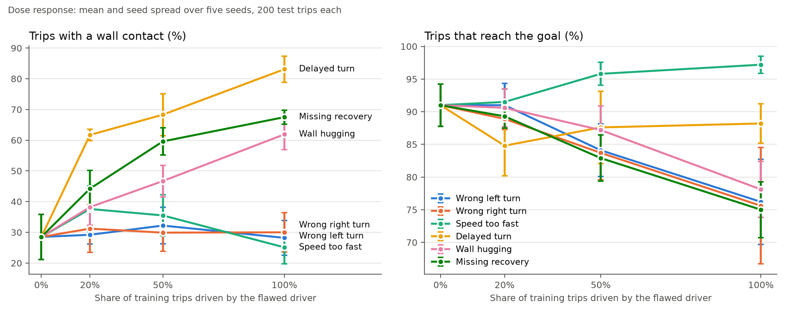

The flawed trips are nested: the 100 trips of the 20% datasets are inside the 250 trips of the 50%
datasets, which are inside all 500 trips of the 100% datasets.

| Dataset | Flawed trips | Error steps | Success | Collisions | Change in collisions | Path efficiency | Time to goal (steps) |
| --- | --- | --- | --- | --- | --- | --- | --- |
| clean data | 0 | 0 | 91.0 ± 3.2% | 28.5 ± 7.4% | | 0.887 ± 0.025 | 250 ± 11 |
| wrong_left | 100 | 2,100 | 91.0 ± 3.4% | 29.2 ± 3.1% | +0.7 | 0.856 ± 0.020 | 262 ± 9 |
| wrong_left_p50 | 250 | 5,650 | 84.1 ± 4.0% | 32.2 ± 5.9% | +3.7 | 0.823 ± 0.027 | 271 ± 9 |
| wrong_left_p100 | 500 | 11,425 | **76.2 ± 6.5%** | 28.2 ± 5.6% | -0.3 | 0.804 ± 0.021 | 275 ± 9 |
| wrong_right | 100 | 2,225 | 88.9 ± 1.6% | 31.2 ± 7.8% | +2.7 | 0.875 ± 0.020 | 258 ± 7 |
| wrong_right_p50 | 250 | 5,675 | 83.7 ± 4.1% | 29.9 ± 6.1% | +1.4 | 0.842 ± 0.010 | 263 ± 5 |
| wrong_right_p100 | 500 | 11,425 | 75.6 ± 8.9% | 30.0 ± 6.4% | +1.5 | 0.810 ± 0.014 | 273 ± 17 |
| speed_fast | 100 | 12,074 | 91.5 ± 2.0% | 37.6 ± 7.5% | +9.1 | 0.897 ± 0.023 | 233 ± 9 |
| speed_fast_p50 | 250 | 32,643 | 95.8 ± 1.8% | 35.5 ± 6.7% | +7.0 | 0.916 ± 0.018 | 213 ± 3 |
| speed_fast_p100 | 500 | 65,274 | 97.2 ± 1.3% | 25.1 ± 5.4% | -3.4 | 0.931 ± 0.012 | 194 ± 4 |
| delayed_turn | 100 | 10,617 | 84.8 ± 4.6% | **61.7 ± 1.9%** | **+33.2** | 0.796 ± 0.021 | 275 ± 7 |
| delayed_turn_p50 | 250 | 29,116 | 87.6 ± 5.5% | **68.3 ± 6.8%** | **+39.8** | 0.766 ± 0.028 | 286 ± 13 |
| delayed_turn_p100 | 500 | 60,356 | 88.2 ± 3.0% | **83.1 ± 4.2%** | **+54.6** | 0.671 ± 0.016 | 318 ± 10 |
| wall_hugging | 100 | 17,015 | 90.6 ± 2.9% | 38.2 ± 5.8% | +9.7 | 0.876 ± 0.014 | 258 ± 8 |
| wall_hugging_p50 | 250 | 44,984 | 87.2 ± 3.7% | **46.7 ± 5.1%** | **+18.2** | 0.836 ± 0.018 | 270 ± 5 |
| wall_hugging_p100 | 500 | 91,073 | **78.1 ± 4.3%** | **61.9 ± 5.0%** | **+33.4** | 0.730 ± 0.011 | 310 ± 4 |
| missing_recovery | 100 | 2,290 | 89.3 ± 1.8% | **44.2 ± 6.0%** | **+15.7** | 0.873 ± 0.018 | 249 ± 2 |
| missing_recovery_p50 | 250 | 5,818 | **82.9 ± 3.5%** | **59.6 ± 4.4%** | **+31.1** | 0.822 ± 0.031 | 255 ± 9 |
| missing_recovery_p100 | 500 | 11,331 | **75.0 ± 4.3%** | **67.5 ± 2.3%** | **+39.0** | 0.785 ± 0.017 | 249 ± 6 |

* **The delayed turn, missing recovery and wall hugging all get worse as the share grows.** Wall contact
  climbs to 83%, 68% and 62% of trips at 100%. Wall hugging passes the rule from 50% on; at 20% its effect
  was still inside the seed spread.
* **Wrong turns never raise wall contact, but they lower success.** Success falls from about 90% to about 76% at
  100% for both turns (both pass once intervals are used, see the Statistics section). The failed trips run out of time about one cell from
  the goal after travelling about 10 units: the policy gets lost instead of hitting walls. So the null
  result for wrong turns at 20% does not hold at higher shares.
* **Speed too fast helps when it is the only speed in the data.** At 100% it gives the highest success
  (97%), the shortest trips (194 steps) and the fewest wall contacts (25%). For this maze, a speed cap of
  3.0 is a valid faster driving style, and it hurts only when mixed with the normal speed of 2.0.

### The same amount of wrong data for every error

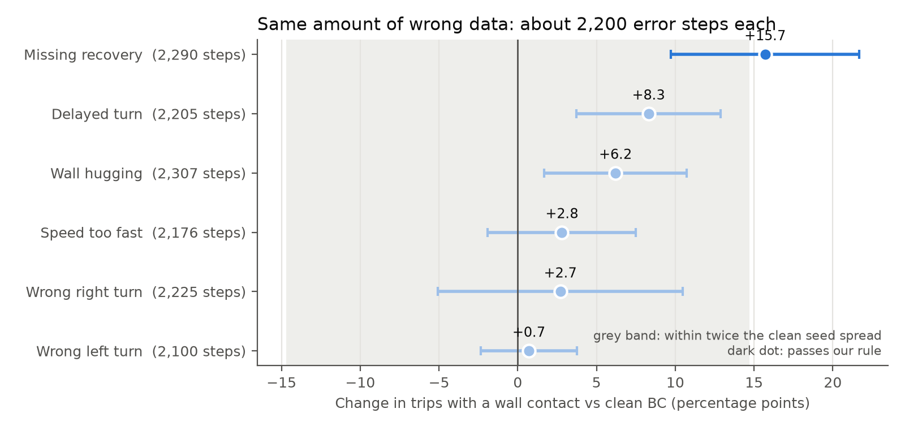

At 20%, the wrong turns and missing recovery carry about 2,100 to 2,300 error steps, while the other
three carry 10,600 to 17,000. Here the delayed turn, speed too fast and wall hugging are cut down to
about 2,200 error steps each by corrupting only the first 20, 17 and 11 of the usual 100 trips
(`corrupt.py --trips`).

| Dataset | Flawed trips | Error steps | Success | Collisions | Change in collisions | Path efficiency | Time to goal (steps) |
| --- | --- | --- | --- | --- | --- | --- | --- |
| clean data | 0 | 0 | 91.0 ± 3.2% | 28.5 ± 7.4% | | 0.887 ± 0.025 | 250 ± 11 |
| wrong_left | 100 | 2,100 | 91.0 ± 3.4% | 29.2 ± 3.1% | +0.7 | 0.856 ± 0.020 | 262 ± 9 |
| wrong_right | 100 | 2,225 | 88.9 ± 1.6% | 31.2 ± 7.8% | +2.7 | 0.875 ± 0.020 | 258 ± 7 |
| missing_recovery | 100 | 2,290 | 89.3 ± 1.8% | **44.2 ± 6.0%** | **+15.7** | 0.873 ± 0.018 | 249 ± 2 |
| delayed_turn_n20 | 20 | 2,205 | 93.6 ± 1.6% | 36.8 ± 4.6% | +8.3 | 0.872 ± 0.005 | 255 ± 4 |
| speed_fast_n17 | 17 | 2,176 | 91.8 ± 2.8% | 31.3 ± 4.7% | +2.8 | 0.895 ± 0.006 | 244 ± 3 |
| wall_hugging_n11 | 11 | 2,307 | 90.1 ± 2.8% | 34.7 ± 4.5% | +6.2 | 0.899 ± 0.012 | 245 ± 9 |

* **Missing recovery is the only error that passes the rule at equal amounts.** Per error step it is the
  most harmful error in the study, about 7 points of wall contact per 1,000 error steps.
* **Most of the delayed turn's damage came from its amount.** Its effect drops from +33.2 to +8.3 points
  at the same number of error steps as a wrong turn. It still ranks second, ahead of wall hugging, speed
  too fast and the two wrong turns, but none of these pass the rule at this amount. With intervals the
  delayed turn is borderline (see the Statistics section).

### Pairs of errors and the mixed dataset

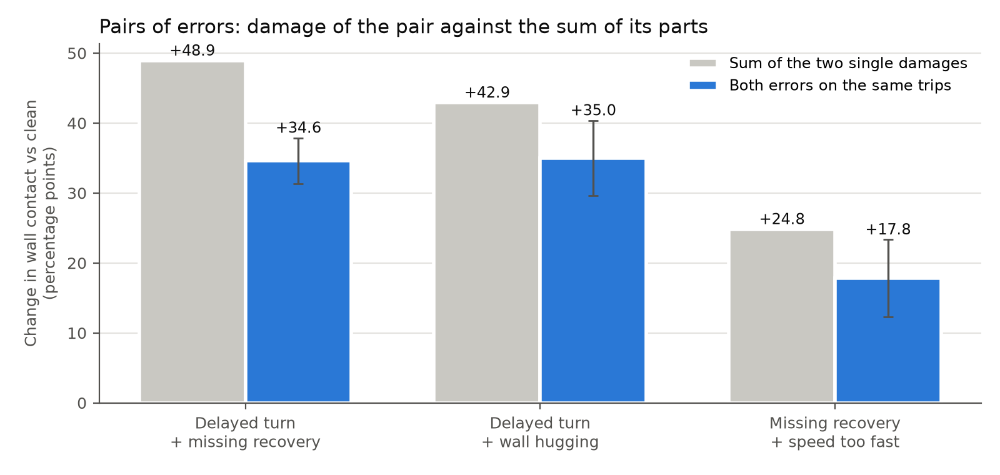

A pair puts both errors on the same 100 flawed trips, so the corrupted share stays at 20%. The mixed
dataset gives each of the 100 flawed trips one of the six errors, taken in turn (17, 17, 17, 17, 16 and
16 trips).

| Dataset | Flawed trips | Error steps | Success | Collisions | Change in collisions | Path efficiency | Time to goal (steps) |
| --- | --- | --- | --- | --- | --- | --- | --- |
| clean data | 0 | 0 | 91.0 ± 3.2% | 28.5 ± 7.4% | | 0.887 ± 0.025 | 250 ± 11 |
| delayed_turn_and_missing_recovery | 100 | 10,802 | 81.6 ± 5.8% | **63.1 ± 3.3%** | **+34.6** | 0.792 ± 0.027 | 272 ± 8 |
| delayed_turn_and_wall_hugging | 100 | 25,393 | 89.2 ± 4.0% | **63.5 ± 5.4%** | **+35.0** | 0.798 ± 0.029 | 280 ± 13 |
| missing_recovery_and_speed_fast | 100 | 12,533 | 90.9 ± 2.5% | **46.3 ± 5.5%** | **+17.8** | 0.855 ± 0.023 | 240 ± 11 |
| mixed | 100 | 7,102 | 86.1 ± 3.8% | **48.1 ± 3.6%** | **+19.6** | 0.838 ± 0.018 | 261 ± 3 |

The interaction on collision rate is I = m(A+B) − m(A) − m(B) + m(clean): zero when the damages add up,
above zero when the pair hurts more than its parts together, below zero when it hurts less. The standard
error combines the seed spreads of the four datasets and treats them as independent, while they share
seeds and test trips. The Statistics section recomputes the interaction seed by seed and with a bootstrap;
those intervals are the ones to rely on.

| Pair | Interaction (points) | Standard error |
| --- | --- | --- |
| delayed_turn + missing_recovery | −14.3 | 4.6 |
| delayed_turn + wall_hugging | −7.9 | 4.9 |
| missing_recovery + speed_fast | −7.0 | 5.9 |

* **No pair makes the damage worse.** All three are below additive in these data. The delayed turn with
  missing recovery is the clearest case (the trip bootstrap excludes zero, the five seeds alone do not):
  that pair touches a wall on 63% of trips, about the same as the delayed turn
  alone. Two things push in this direction. Wall contact is a yes or no per trip, so a trip that already
  hits a wall cannot count twice. The pair packs both errors into the same 100 trips, which leaves fewer
  error steps (10,802) than the two single datasets hold between them (12,907).
* **The mixed dataset hurts more than the average single error dataset:** 48.1% wall contact against
  40.3%, a gap of 7.8 points (standard error 1.9). One possible reading: the dose curves above are
  steepest at small shares, so six errors on about 17 trips each add up to more damage than one error on
  100 trips. This is a hypothesis, not yet tested.

## Brick 8 results: can the policy's behavior reveal its training error? (November 24, 2026)

Every trained policy drives the same 200 test trips. This step asks whether those trips alone are enough to
name the mistake in the policy's training data. The classifier never sees the training data, only the
trip log of the policy (`results/trips/<model>.csv`).

**Method.** Each policy is reduced to eight numbers: success rate, collision rate, share of trips that hit
the 600 step cap, steps divided by the expert's steps on the same trips, distance per step, path
efficiency on completed trips, mean distance to the goal at the end of failed trips, and wall contact
steps per trip that touched a wall. Two small models are compared: logistic regression on standardized
inputs and a random forest with 300 trees. Scoring leaves one seed out: train on the policies of four
seeds, predict the fifth, rotate five times. Every policy is predicted by a model that has not seen its
seed.

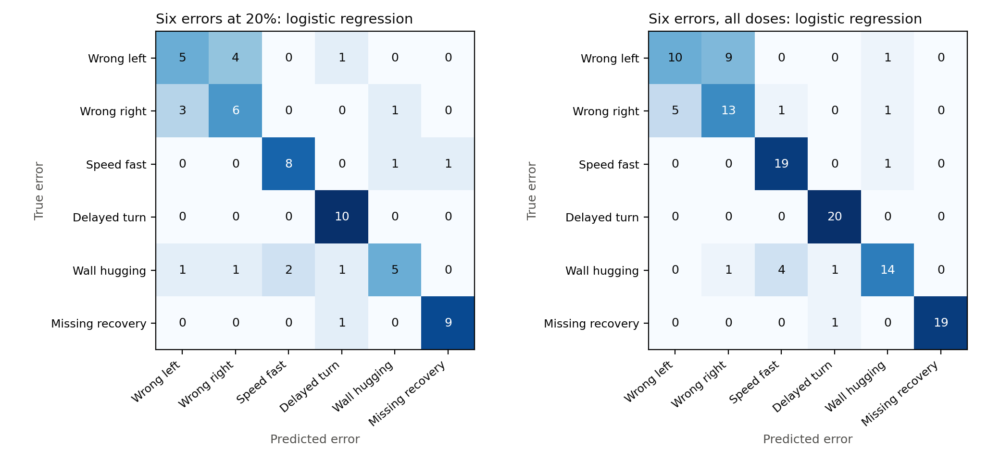

| Run | Policies | Chance | Logistic regression | Random forest |
| --- | --- | --- | --- | --- |
| Six errors at 20% (main result) | 30 | 16.7% | **83.3%** | 56.7% |
| Same, wrong left and wrong right counted as one class | 30 | | 90.0% | 60.0% |
| Six errors at 20%, 50% and 100% | 90 | 16.7% | 80.0% | 74.4% |
| Same, wrong turns counted as one class | 90 | | 90.0% | 90.0% |
| Clean added as a seventh class (20%) | 35 | 14.3% | 60.0% | 54.3% |

Share of policies named correctly in the main run, logistic regression (5 policies per error):

| Wrong left | Wrong right | Speed too fast | Delayed turn | Wall hugging | Missing recovery |
| --- | --- | --- | --- | --- | --- |
| 60% | 80% | 100% | 100% | 60% | 100% |

* **Three errors leave a clear trace.** Speed too fast, delayed turn and missing recovery were named
  correctly for all 5 policies each in the main run, and for 15 of 15, 14 of 15 and 15 of 15 policies when
  the doses are pooled.
* **The two wrong turns look alike.** Wrong left and wrong right are mostly confused with each other
  (1 of 5 each way in the main run, 9 of 15 and 10 of 15 correct when the doses are pooled). Counting them
  as one class gives 90%.
* **Wall hugging sits close to the wrong turns.** 3 of 5 were named correctly, and the two misses were
  both called wrong right. Its collision rate (38.2%) is close to those of the wrong turns (29.2% and 31.2%).
* **A clean policy is not recognized as clean.** With clean as a seventh class, only 1 of 5 clean policies
  was named clean. The classifier says which mistake fits best, not whether there was a mistake. The
  collision rate of clean BC (28.5%) is already close to the wrong turns.
* **No single number carries the result.** Dropping the collision rate lowers the main score to 63.3%,
  dropping the speed to 66.7%, and dropping any one of the other six to between 76.7% and 80.0%.
* **The simple model wins at this size.** With 30 policies the random forest falls to 56.7%, mostly on the
  wrong turns and wall hugging. It catches up in the pooled run, which has three times the data.
* **Not a chance result.** Shuffling the labels 300 times and scoring the same way gave 11.3% on average
  and 33.3% at best (a separate check, not part of `classify_error.py`).

**A dose it has never seen.** The pooled run above lets the classifier learn an error from its other
doses, so it never has to recognize an unfamiliar corruption strength. The harder version trains on two
doses and tests on the third, with the test policy's seed left out of training as well, so the model has
seen neither that dose nor that seed.

| Held out dose | Logistic regression | Wrong turns merged | Random forest |
| --- | --- | --- | --- |
| 20% | 63.3% | 70.0% | 60.0% |
| 50% | 90.0% | 96.7% | 80.0% |
| 100% | 66.7% | 83.3% | 66.7% |
| All three together | 73.3% | 83.3% | 68.9% |

Chance is 16.7%. The 50% dose is the easy one: it sits between the other two, so the classifier only has
to interpolate. The 20% and 100% doses sit at the ends and have to be extrapolated to, which costs about
25 points. Naming the error at a strength never seen in training still works far above chance.

**Clean or flawed, as a first stage.** A two stage diagnosis would ask whether a policy learned from
flawed data at all, then which mistake. The first stage is the weak one. With 5 clean and 30 flawed
policies and the two classes weighted equally:

| Model | Clean found | Flawed found | Balanced accuracy |
| --- | --- | --- | --- |
| Logistic regression | 3 of 5 | 73.3% | 66.7% |
| Random forest | 0 of 5 | 93.3% | 46.7% |

Chance for balanced accuracy is 50%. Logistic regression is a little above it and the forest is at it.
With five clean policies each one moves that column by 20 points, and the random forest row shifts
between scikit learn builds, while every logistic regression number here was identical on two machines.
Naming the error among flawed policies is the part that works; deciding whether there was an error at
all is not yet usable.

Limits: five policies per error, so one miss moves a score by 3.3 points; one maze, and the same 200 test
trips for every policy; and the classifier chooses among the six known errors only, so it says nothing
about an error type it has not seen.

## Statistics: intervals, correction and seed checks (November 24, 2026)

The rule used so far (a difference passes when it is larger than twice the larger seed spread) is a quick
guide, not a test. `src/stats_brick9.py` measures the same uncertainty three ways, each with its own
weakness.

* **A permutation test** gives the p value. The five clean policies and the five flawed ones are pooled
  and split again in all 252 ways, with the test trips held fixed. The p value is the share of splits
  whose gap is at least as large as the one we saw. This treats the trained policy as the unit, which is
  the unit the experiment actually varies, and it assumes the ten policies can be freely relabeled against
  each other. The five seed numbers are shared across every dataset, so this is an assumption rather than
  a fact about the data; the Limitations section says more. For the six single errors at 20% these p
  values are corrected with Holm's method.
* **A paired permutation test** is the matched version of that test, added after a reviewer asked for it.
  Seed s of a dataset and seed s of clean BC are a pair, and the label inside a pair is flipped in all
  2^5 = 32 ways. It respects the pairing the test above assumes away, and it is coarser for it: the
  smallest p value it can give is 2/32 = 0.0625, and the smallest after Holm correction for six errors
  is 0.375, so at five seeds it cannot certify anything at 0.05 however large the effect.
* **A paired bootstrap** gives the interval. Each draw picks 200 trip positions once and applies them to
  every dataset, so the trips stay paired, and picks five training seeds with replacement, 10,000 draws
  in all.
* **A seed t interval** is the matched check: seed s of a dataset against seed s of clean BC, five
  differences, a t interval. It uses the shared seed numbers that the bootstrap throws away.

A result counts as solid when the bootstrap interval and the seed interval both exclude zero. Five
policies against five put a floor under the unpaired permutation test: the smallest p value it can give
is 2/252 = 0.0079, so after Holm correction for six errors nothing can fall below 0.048. Two errors reach
that floor, and more seeds are the only way past it.

The paired test has a higher floor still, 0.0625 before correction and 0.375 after it. Delayed turn,
missing recovery and wall hugging all land on that floor, which means every one of their five seed
differences points the same way and no relabeling of the pairs gives a larger mean difference. That is
the strongest signal the paired test can produce, and it is still short of 0.05 by construction. So the
two tests bracket what five seeds support: the unpaired one clears the correction while assuming the
pairing away, the paired one honours the pairing and lacks the resolution to conclude. The paired
test cannot separate wall hugging from the two headline errors either; the unpaired test does, at 0.040
against 0.008. Ten seeds would move the paired floor to about 0.002 before correction and 0.012 after
it, which is the single change that would most improve the evidence here.

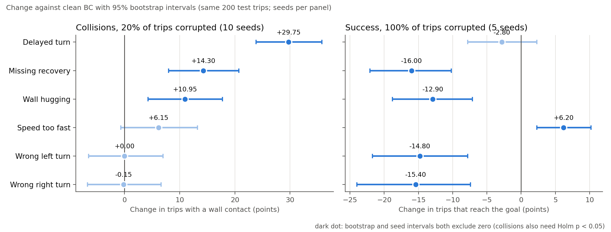

Dark dots mark results where the bootstrap interval and the seed interval both exclude zero; for collisions
the Holm corrected p value must be below 0.05 too.

| Error at 20% | Collision change | Bootstrap interval | Seed interval | Permutation p | Holm p |
| --- | --- | --- | --- | --- | --- |
| Delayed turn | +33.2 | 25.2 to 41.7 | 23.0 to 43.4 | 0.008 | 0.048 |
| Missing recovery | +15.7 | 6.8 to 25.1 | 3.9 to 27.5 | 0.008 | 0.048 |
| Wall hugging | +9.7 | 1.0 to 18.9 | 3.6 to 15.8 | 0.040 | 0.159 |
| Speed too fast | +9.1 | −0.6 to 19.1 | −2.0 to 20.2 | 0.087 | 0.262 |
| Wrong right turn | +2.7 | −6.9 to 12.8 | −12.5 to 17.9 | 0.619 | 1.000 |
| Wrong left turn | +0.7 | −7.1 to 9.3 | −10.3 to 11.7 | 0.905 | 1.000 |

* **Delayed turn and missing recovery are solid.** Both intervals exclude zero and both reach the floor
  of the permutation test, 0.048 after correction. No arrangement of these five seeds separates the two
  groups more sharply than the one we got.
* **Wall hugging is suggestive at 20%.** Both intervals exclude zero and the raw permutation p value is
  0.040, which does not survive the correction for six comparisons. At 50% and 100% it is solid.
* **Wrong turns and speed too fast show no collision effect at 20%.**
* **Success at higher shares.** Both wrong turns lose about 15 points at 100% (−14.8 and −15.4), and both
  intervals exclude zero. Missing recovery loses 8.1 points at 50% and 16.0 at 100%. Wall hugging loses
  12.9 at 100%. Speed too fast gains 6.2 at 100%. At 50%, wrong left (−6.9) is solid, while wrong right
  (−7.3) holds only in the bootstrap.
* **Equal amounts.** Missing recovery stays the one error clearly above zero. Delayed turn cut to 20
  trips is borderline (bootstrap −0.1 to 17.3, seed interval 2.7 to 13.9).

**Efficiency counted over all trips.** The path efficiency in the results tables above is measured on
completed trips only, so a policy that fails its hardest trips can look efficient on the ones that are
left. The same script measures a second version over all 200 trips, with a failed trip counted as zero.
Clean BC scores 80.7 on that scale. The change against it:

| Error | At 20% | At 100% |
| --- | --- | --- |
| Delayed turn | **−13.2** | −21.6 |
| Wall hugging | −1.4 | −23.7 |
| Missing recovery | −2.8 | −21.8 |
| Wrong right turn | −2.9 | −19.5 |
| Wrong left turn | −2.9 | −19.4 |
| Speed too fast | +1.4 | +9.8 |

At 20% the delayed turn is the only error that moves this measure (bold: both intervals exclude zero and
the corrected p value is 0.048). At 100% every error except speed too fast costs about 20 points, and the
two wrong turns, which never raise wall contact, lose as much as the rest. Speed too fast gains on both
measures.

| Pair | Interaction (points) | Seed interval | Bootstrap interval |
| --- | --- | --- | --- |
| delayed_turn + missing_recovery | −14.3 | −30.3 to +1.7 | −27.3 to −2.5 |
| delayed_turn + wall_hugging | −7.9 | −18.2 to +2.4 | −17.2 to +1.5 |
| missing_recovery + speed_fast | −7.0 | −21.9 to +7.9 | −19.3 to +4.6 |
| mixed minus average of the six single errors | +7.8 | +2.0 to +13.5 | +1.9 to +13.4 |

No pair is clearly above additive. The first pair is below additive in the bootstrap but not in the seed
interval. The mixed dataset is above the average of the singles in both, and all five seeds agree (+1.3
to +12.5). Only the six single errors at 20% are corrected for multiple comparisons; the dose, matched
and pair rows show raw intervals. With five seeds the seed part is estimated roughly, and bootstrap
intervals tend to run a little narrow. `results/brick9_changes.csv`, `results/brick9_interactions.csv` and
`results/brick9_seed_results.csv` hold every interval and the score of every policy.

## Generalization: routes the training data never contained (November 24, 2026)

The 200 test trips are drawn from the same maze cells as the 500 training trips, so a fair question is
whether a policy is only repeating routes it was taught. The maze has 26 open cells, which gives 650
ordered start and goal pairs, and the 500 training trips cover 359 of them. Of the 200 test trips, 114
use a pair that appears in training and **86 use a pair that never appears**. Every single cell appears
in training as both a start and a goal, so an unseen trip is a new route through a known maze, not a new
maze. `src/generalization.py` splits the test trips on that line and scores both halves from the trip
logs, with nothing retrained, after checking every policy's trips against the reference order the same
way `stats_brick9.py` does.

| | Seen pairs (114) | Unseen pairs (86) |
| --- | --- | --- |
| Clean BC, success | 90.9% | 91.2% |
| Clean BC, wall contact | 27.4% | 30.0% |
| Delayed turn, change in wall contact | +32.6 | +34.0 |
| Missing recovery, change in wall contact | +16.5 | +14.7 |
| Wall hugging, change in wall contact | +11.4 | +7.4 |
| Speed too fast, change in wall contact | +9.8 | +8.1 |
| Wrong turns at 100%, change in success | −15.4 and −17.0 | −14.0 and −13.3 |
| Speed too fast at 100%, change in success | +7.7 | +4.2 |
| Wall hugging at 100%, change in success | −10.9 | −15.6 |
| Missing recovery at 100%, change in success | −16.7 | −15.1 |

* **Clean BC drives both halves equally well.** 90.9% against 91.2% success, and 27.4% against 30.0% wall
  contact. The unseen pairs are no harder than the seen ones, which is what we would expect when the
  policy has learned to drive the maze rather than to replay routes.
* **Every ranking holds on the unseen half.** The delayed turn stays by far the worst, missing recovery
  second. No error changes sign.
* **The speed too fast benefit at 100% survives.** Success is still above clean BC on pairs the training
  data never contained, and wall contact is still lower, so the gain is a faster driving style rather
  than a memorized set of routes.

The full table for all 26 datasets is in `results/generalization.csv`.


## Limitations

* One maze (PointMaze Medium) and one behavior cloning network. The results say nothing about other
  layouts or other learners.
* The unseen test trips in the Generalization section are new start and goal pairs inside the same maze.
  Every cell appears in training as both a start and a goal, so that section tests new routes, not a new
  layout.
* Five policies against five put a floor of 0.0079 under any permutation p value here, and 0.048 after
  the correction for six errors. Two errors sit at that floor, and nothing in this study can report a
  smaller p value without more training seeds.
* The unpaired permutation test assumes the ten training runs it reshuffles are independent of each
  other. The five seed numbers are shared across every dataset and set the starting weights and the
  minibatch order for all of them, so the runs are matched by seed rather than ten unrelated draws. The
  seed t interval and the paired permutation test both use that matching directly, and the two results
  marked solid pass the seed interval as well, but the unpaired p value by itself rests on the
  independence assumption and the paired test has no resolution to settle it at five seeds.
* Five training seeds per dataset. Brick 8 has five policies per error type, so one wrong prediction
  moves its score by 3.3 points.
* Every model is the one after 120 epochs, with no validation split and no checkpoint choice. The epoch
  count was set by looking at clean data success on the test trips (see Design decisions).
* Only 84 of the 100 flawed wrong left trips and 89 of the 100 wrong right trips contain the mistake, so
  the effective share of trips with the mistake is a little below the nominal 20%.
* Every condition uses one corrupted dataset, built from one draw of which trips to spoil. The five
  seeds vary the training run, not the draw, so the numbers do not say how much a different draw of the
  same 20% would move them.
* Established results are the ones marked solid in the Statistics section. The explanation of the mixed
  dataset (dose curves that are steepest at small shares) and the reading of the wrong turn failures as
  getting lost are hypotheses.


## Setup (Windows, macOS or Linux)

Run everything from the repository root. Python 3.11 was used; 3.10 to 3.12 should work.

With Anaconda (used for this project on Windows):

```bash
conda create -n ilproject python=3.11 -y
conda activate ilproject
pip install -r requirements.txt
```

With plain Python:

```bash
python -m venv .venv
.venv\Scripts\activate          # Windows.  On macOS/Linux: source .venv/bin/activate
pip install -r requirements.txt
```

## Reproducing the results

```bash
python src/check_env.py                       # last line must say ALL GOOD
python src/make_expert_data.py --episodes 500 # clean data: 500 trips, 106,543 steps
python src/plot_trajectories.py               # figures/expert_trajectories.png
python src/corrupt.py --error all             # all seven corrupted datasets, plots and data/exposure.csv

# five seeds per dataset, about one minute each on a CPU
python src/train_bc.py --data data/expert_clean.npz --seed 0
python src/train_bc.py --data data/wrong_left.npz --seed 0
python src/train_bc.py --data data/wrong_right.npz --seed 0
python src/train_bc.py --data data/speed_fast.npz --seed 0
python src/train_bc.py --data data/delayed_turn.npz --seed 0
python src/train_bc.py --data data/wall_hugging.npz --seed 0
python src/train_bc.py --data data/missing_recovery.npz --seed 0
# then the same commands with --seed 1, 2, 3 and 4

python src/evaluate.py --expert               # scores every model in models/, writes results/results.csv
```

Brick 7 (dose, matched error steps, pairs and the mixed dataset):

```bash
python src/corrupt.py --error all --check     # a one part ComboDriver must reproduce each single error dataset

python src/corrupt.py --error delayed_turn+missing_recovery
python src/corrupt.py --error delayed_turn+wall_hugging
python src/corrupt.py --error missing_recovery+speed_fast
python src/corrupt.py --error mixed

python src/corrupt.py --error delayed_turn --trips 20 --no-plot
python src/corrupt.py --error speed_fast --trips 17 --no-plot
python src/corrupt.py --error wall_hugging --trips 11 --no-plot

python src/corrupt.py --error wrong_left --fraction 0.5 --no-plot   # and --fraction 1.0, for all six errors

python src/run_brick7.py                      # trains and scores five seeds of every dataset; skips models already scored
python src/analyze_brick7.py                  # Brick 7 tables and figures
```

Brick 8 (error type classifier, reads `results/trips`, no training, under a minute):

```bash
python src/classify_error.py                  # scores, confusion matrices and figures/brick8_confusion.png
```

Brick 9 (statistics, reads `results/trips`, no training, under a minute):

```bash
python src/stats_brick9.py                    # intervals, Holm correction, interactions; writes results/brick9_*.csv and figures/brick9_intervals.png
```

Generalization (splits the test trips into seen and never seen start and goal pairs, no training):

```bash
python src/generalization.py                  # writes results/generalization.csv
```

Running `evaluate.py` again replaces a model's row, so `results/results.csv` never holds duplicates, and
two runs give identical numbers. The file `results/trips/<model>.csv` keeps one row per test trip (end
point, first wall contact and so on) as input for the error type classifier.

Every run prints a warning about the `AdroitHand` environments. It concerns other robots in the same
package and does not affect this project.

## Repository layout

```
src/        all code; src/common.py defines the environment and the expert
data/       generated datasets (.npz, .csv); only the clean expert data is in git
models/     trained policies (.pt); only the five clean baseline models are in git
figures/    plots: expert trips, clean versus corrupted trips
results/    evaluation tables, not in git
```

The corrupted datasets, the other models and the results are not in git. Every script rebuilds them
exactly from fixed seeds on the same computer (see the note on computers under Design decisions).

## The environment and the expert

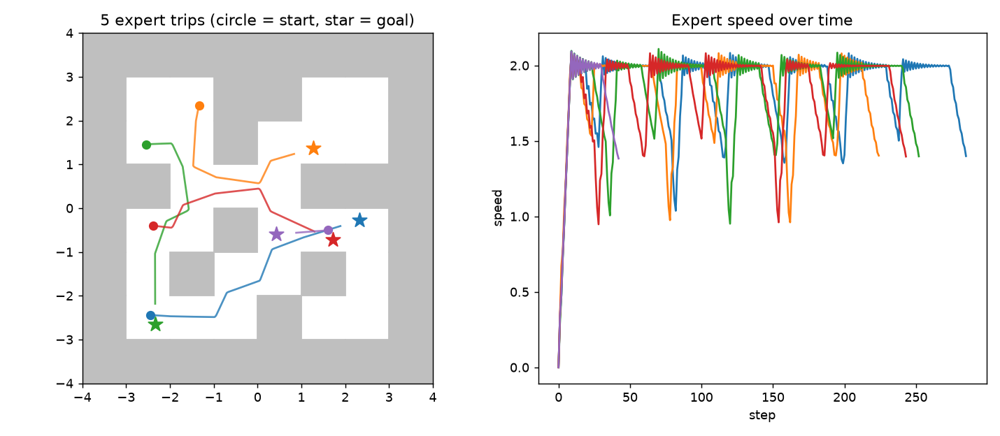

* Environment: `PointMaze_Medium-v3` from Gymnasium Robotics. A ball with momentum rolls in an 8 by 8
  maze whose outer ring is wall. A trip ends at the goal or after 600 steps.
* State: `[x, y, vx, vy]` and the goal `[goal_x, goal_y]`, six numbers in total.
* Action: `[fx, fy]`, a push between −1 and 1.
* Expert: a breadth first search over maze cells plans the route, and a PD controller with a speed cap
  steers along it (`src/common.py`). It succeeds on all 500 trips (106,543 steps, trips from 15 to 463
  steps long).
* Medium was chosen over UMaze: on UMaze clean BC already scores 100%, which leaves no room to measure
  damage. On Medium, clean BC scores about 90%.

## How the corrupted datasets are built (`src/corrupt.py`)

Each corrupted dataset replays exactly the same 500 trips as the clean data, with the same start, goal
and seed. A fixed 20% of trips, the same 100 for every error type, are driven by a flawed driver. The
other 400 trips match the clean data exactly. The flawed driver really drives the ball, so every recorded
state is the true result of the action before it. Editing actions inside the finished file would break
that link.

| Error | What the flawed driver does | Trips that contain it |
| --- | --- | --- |
| `wrong_left` | At one random junction with an open corridor on its left, it drives into the corridor for 25 steps, then plans a new route | 84 of 100 |
| `wrong_right` | The same, to the right | 89 of 100 |
| `speed_fast` | Speed cap of 3.0 instead of 2.0 for the whole trip | 100 of 100 |
| `speed_slow` | Speed cap of 1.0; 10 trips run out of time, so it is not in the results yet | 100 of 100 |
| `delayed_turn` | At every corner it keeps going straight for 45 steps, overshoots into the wall ahead, then turns | 85 of 100 |
| `wall_hugging` | Obstacle mistake: aims 0.38 toward a side wall instead of the cell center, leaving a gap of 0.02 | 99 of 100 |
| `missing_recovery` | Gets pushed off its route once per trip (force 0.5 for 25 steps). The slip is recorded, and the steps that steer back are left out of the data | 96 of 100 |

Some routes have no side corridor on the chosen side or no corner, and those trips stay clean. Each
strength was tuned until the mistake was clearly visible: on flawed trips the ball touches a wall on 79%
(delayed turn), 32% (wall hugging) and 26% (missing recovery) of trips. The expert never touches a wall.

| Wrong left turn | Wrong right turn |
| --- | --- |
| 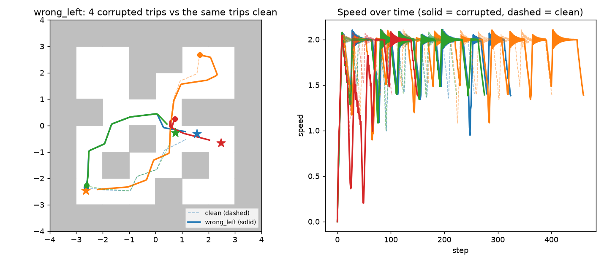 | 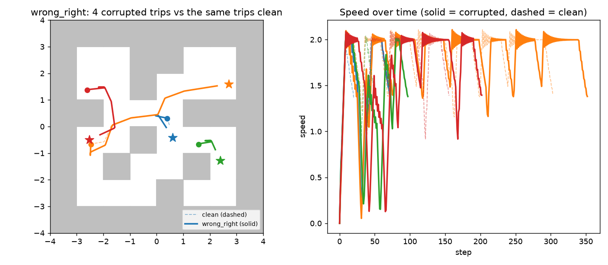 |
| **Speed too fast** | **Speed too slow** |
| 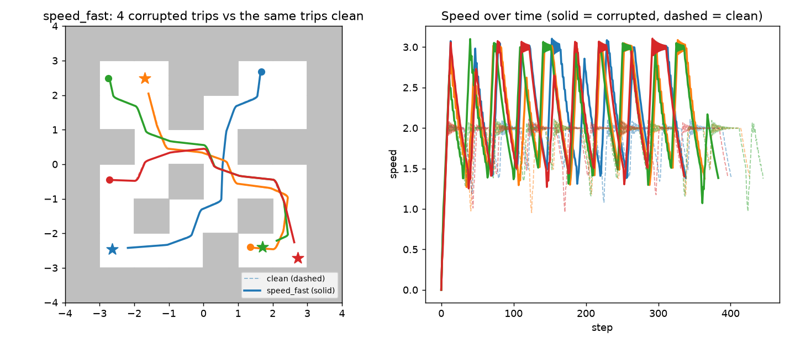 | 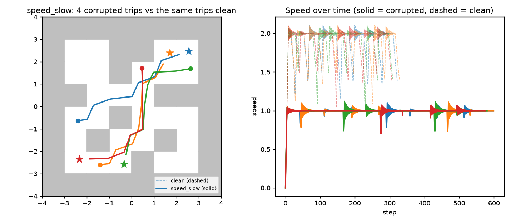 |
| **Delayed turn** | **Wall hugging** |
| 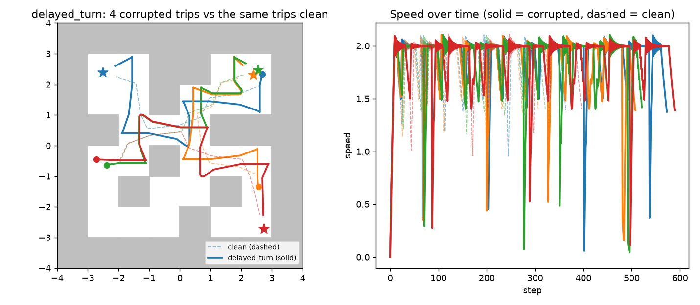 | 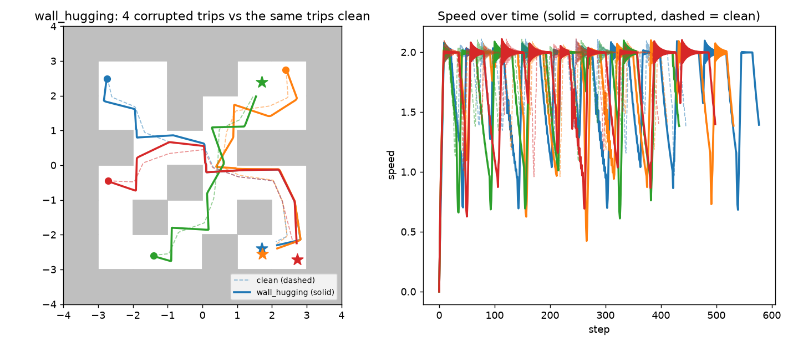 |
| **Missing recovery** | |
| 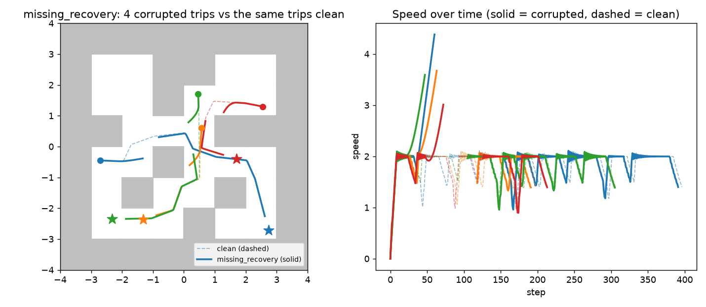 | |

Solid lines are corrupted trips. Dashed lines are the same trips driven by the expert. Gaps in a
missing recovery line are the steps left out of the data.

### How much of each dataset is wrong

Corrupting the same 100 trips does not give every error type the same amount of wrong behavior. A wrong
turn is one detour of 25 steps, while a delayed turn repeats at every corner and wall hugging lasts most of
a trip. Each flawed driver marks the steps where its error is active. This is only counted and never
changes the data: the datasets are byte identical to the ones built before the counting was added. The
marks are stored as an `error_active` column in each dataset, and `data/exposure.csv` holds the totals.

| Error | Trips with the error | Error events | Steps with the error active | Share of all training steps | Steps left out |
| --- | --- | --- | --- | --- | --- |
| `wrong_left` | 84 | 84 | 2,100 | 1.9% | 0 |
| `wrong_right` | 89 | 89 | 2,225 | 2.0% | 0 |
| `missing_recovery` | 96 | 96 | 2,290 | 2.2% | 1,550 |
| `delayed_turn` | 85 | 236 | 10,617 | 9.2% | 0 |
| `speed_fast` | 100 | 100 | 12,074 | 11.6% | 0 |
| `wall_hugging` | 99 | 99 | 17,015 | 15.4% | 0 |
| `speed_slow` | 100 | 100 | 35,257 | 28.9% | 0 |

What counts as active: the 25 detour steps of a wrong turn, the 45 straight steps after each corner of a
delayed turn, the steps aimed at a shifted point for wall hugging, the 25 push steps for missing recovery,
and for speed errors the steps where the wrong speed cap changes the command. For missing recovery the
1,550 steps left out are counted on their own, since they are missing data, not wrong data.

Three things stand out. The wrong turns carry about five times fewer error steps than the delayed turn,
so part of the gap between them may come from dose and not from the kind of error. The delayed turn has
fewer error steps than the fast speed error or wall hugging, yet the largest effect, so step count alone
does not explain its ranking. Missing recovery has almost as few error steps as a wrong turn (2,290
against 2,100), yet a clear effect, while the wrong turns show none. A run at matched numbers of error
steps will test this directly.

## Metrics (`src/evaluate.py`)

| Metric | Definition | Measured on |
| --- | --- | --- |
| Success rate | Share of test trips that reach the goal within 600 steps | All trips |
| Collision rate | Share of trips with at least one real wall contact: a MuJoCo contact between `particle_geom` and a `block_*` geom with distance ≤ 0 | All trips |
| Path efficiency | Distance the expert travels on the same trip divided by the distance the policy travels (expert = 1.0) | Successful trips |
| Time to goal | Steps until the goal is reached | Successful trips |

Path efficiency and time to goal are averaged over the trips each policy completes. Two policies that fail
on different trips are therefore compared on slightly different sets of trips; the success rate shows how
large that difference can be.

Two definitions changed after testing:
* MuJoCo reports near contacts inside a 2 mm safety margin. Counting them raised the clean collision rate
  from about 31% to 42%, so only real touches (distance ≤ 0) count.
* Path efficiency first used the shortest path through cell centers as the reference. The expert itself
  scored 1.41 on that measure, since a real ball cuts corners. The expert's own route on the same trip is
  now the reference.

## Experiment plan

* **Error types:** wrong left turn, wrong right turn, delayed turn, speed error, obstacle mistake and
  missing recovery. Each one is a flawed version of the expert that records its own trips.
* **Datasets:** clean, six single error sets (20% of trips corrupted), three pairs and one mix of all
  errors. Brick 7 added the same six errors at 50% and 100%, and three cut to an equal number of error
  steps, for 26 datasets in total.
* **Runs:** 26 datasets × 5 seeds = 130 BC policies.
* **Fairness:** every policy uses the same network and training settings and drives the same 200 test
  trips. A difference counts as real only when it is larger than about twice the spread between seeds;
  the Statistics section adds paired bootstrap intervals with Holm correction.
* **Test trips:** the 200 test trips are drawn from the same maze cells as the training trips. 114 of
  them use a start and goal pair that appears in training and 86 use a pair that never appears; the
  Generalization section scores both halves. The test measures how well a policy drives this maze, not
  how it handles a new maze.
* **Interaction test:** for errors A and B,
  `interaction = (S_clean − S_AB) − [(S_clean − S_A) + (S_clean − S_B)]`.
  A positive value means the pair hurts more than the two errors added together.

## Design decisions

* **Behavior cloning is written in plain PyTorch instead of the `imitation` library.** Version 1.0.1 of
  `imitation` requires `gymnasium==0.29.1`, which clashes with the current PointMaze (`gymnasium>=1.2`).
  Behavior cloning is supervised regression from state to action, so a short PyTorch script does the job.
  Network: an MLP with layers 6, 128, 128, 2, ReLU activations and a final tanh that keeps the push in
  [−1, 1]. Inputs are scaled by the mean and standard deviation of the training data, stored inside the
  model file. MSE loss, Adam (learning rate 0.001), batch size 256, 120 epochs.
* **120 epochs instead of 40.** In early tests 40 epochs gave 81% to 93% across seeds. 120 epochs gives a
  stronger and steadier baseline, and a weak baseline would blur the damage from each error type. This
  choice was made by looking at clean data success on the same test trips used for the results. It was
  fixed before any corrupted dataset existed and is the same for every dataset, so it favors no error type.
* **Numbers can differ by a few points between computers,** from floating point differences between CPUs
  and library builds, even with the same seed and data. All reported numbers come from one machine.
* **Expert data is generated locally instead of downloaded from Minari.** The project stays standalone,
  and the flawed drivers can see the maze walls.
* The CSV files in `data/` have one row per step, with a `corrupted` column in the corrupted sets, which
  makes them easy to inspect with pandas.
