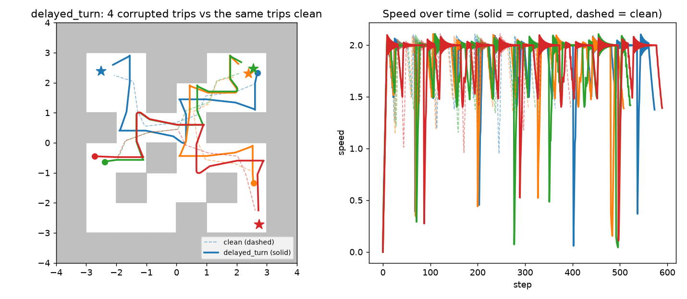
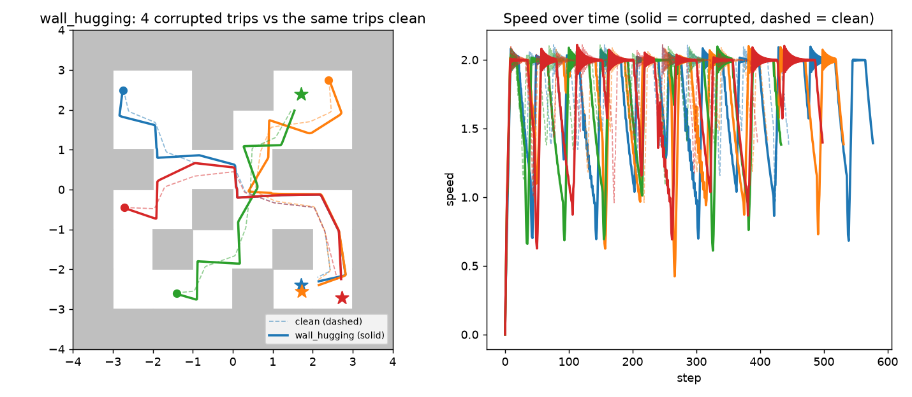
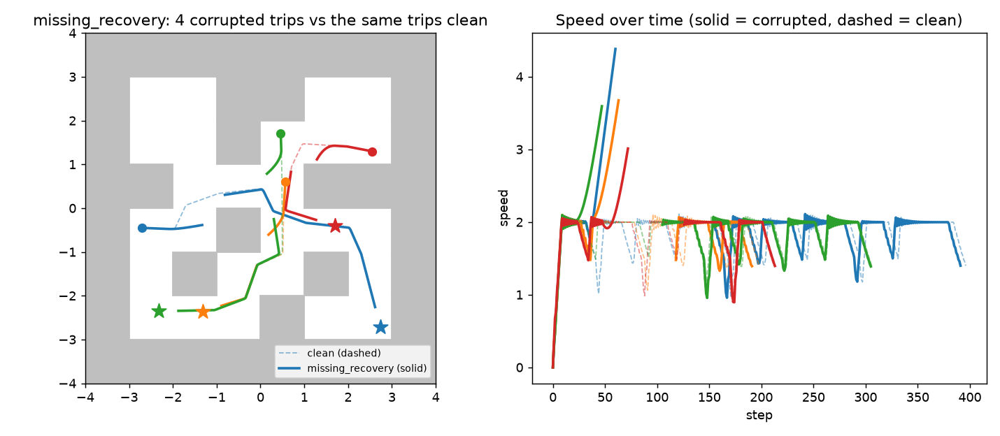

# Impact of Demonstration Error Types on Imitation Learning (PointMaze)

CS59300 ILR course project. The question: which kinds of mistakes in demonstration data hurt a behavior
cloning navigation policy the most, and do combinations of mistakes hurt more than the sum of their parts?

## Project status

| Part | What | File | State |
| --- | --- | --- | --- |
| Environment | PointMaze installs and the expert reaches the goal | `src/check_env.py` | done |
| Expert data | 500 clean expert trips | `src/make_expert_data.py` | done |
| Data plots | Expert trips drawn on the maze | `src/plot_trajectories.py` | done |
| Training | Behavior cloning policy | `src/train_bc.py` | done |
| Evaluation | Four metrics on 200 fixed test trips | `src/evaluate.py` | done |
| Corruptions | Wrong left turn, wrong right turn, speed error | `src/corrupt.py` | done |
| Corruptions | Delayed turn, obstacle mistake (wall hugging), missing recovery | `src/corrupt.py` | done |
| Combinations | Pairs of errors and a mixed dataset | | next |
| Diagnosis | Classifier that guesses the error type from rollouts | | planned |

## Results so far (October 21, 2026)

Five seeds per dataset, 200 fixed test trips (`TEST_SEED = 12345`), mean ± standard deviation across
seeds. In every corrupted dataset, 20% of the 500 training trips contain the error, and they are the
same 100 trips for every error type.

Sorted by the change in collision rate against clean data. Bold marks a difference from clean BC that
passes the rule from the experiment plan below: larger than twice the spread between seeds.

| Policy | Success | Collisions | Change in collisions | Path efficiency | Time to goal (steps) |
| --- | --- | --- | --- | --- | --- |
| Expert driver (upper bound) | 100% | 0% | | 1.000 | 211 |
| BC, clean data | 91.0 ± 3.2% | 28.5 ± 7.4% | | 0.887 ± 0.025 | 250 ± 11 |
| BC, delayed_turn | 84.8 ± 4.6% | **61.7 ± 1.9%** | **+33.2** | **0.796 ± 0.021** | **275 ± 7** |
| BC, missing_recovery | 89.3 ± 1.8% | **44.2 ± 6.0%** | **+15.7** | 0.873 ± 0.019 | 249 ± 2 |
| BC, wall_hugging | 90.6 ± 2.9% | 38.2 ± 5.8% | +9.7 | 0.876 ± 0.014 | 258 ± 8 |
| BC, speed_fast | 91.5 ± 2.0% | 37.6 ± 7.5% | +9.1 | 0.897 ± 0.023 | 233 ± 9 |
| BC, wrong_right | 88.9 ± 1.6% | 31.2 ± 7.8% | +2.7 | 0.875 ± 0.020 | 258 ± 7 |
| BC, wrong_left | 91.0 ± 3.4% | 29.2 ± 3.1% | +0.7 | 0.856 ± 0.020 | 262 ± 9 |

What the numbers show:

* **The delayed turn does the most damage by far.** Wall contact rises from 29% to 62% of trips, and
  the five seeds land between 58.5% and 63.5%. Routes get longer (path efficiency 0.80 against 0.89)
  and trips take 25 steps more; both pass the rule. Success is about 6 points lower on average, but
  that gap does not pass the rule.
* **Missing recovery clearly raises the collision rate,** by about 16 points. Success, path efficiency
  and time stay close to clean.
* **Wall hugging and the fast speed error raise the collision rate by about 9 to 10 points on average,
  but neither passes the rule.** The fast speed error makes trips shorter on average (233 steps
  against 250), which fits a policy that learned to drive faster, but that gap does not pass the rule
  either.
* **Wrong turns show no clear effect.** Both stay within 3 points of clean on collisions, and no other
  metric passes the rule. With three seeds the wrong left turn looked slightly better than clean; with five
  seeds that gap is gone, so it was noise.
* **One clean seed is an outlier.** Clean BC seed 4 touches a wall on only 16% of trips, while the other
  four clean seeds land between 29.5% and 35%. It stays in the results, but it lowers the clean mean and
  widens the clean spread, which makes the rule harder to pass for every error type. A single training
  seed can move the baseline this much, which is why the results use five seeds.

Behavior cloning with a squared error loss learns the average action in each state. An error that pushes
the actions the same way every time it happens survives that averaging: the delayed turn repeats at every
corner of a flawed trip. A wrong turn happens once per trip at a random junction and points a different
way each time, so it averages out. Missing recovery does not fit this pattern: it happens once per trip in
a random direction, yet it clearly hurts. One possible reading is that it works differently: the data
shows the ball drifting off the route but never shows how to get back, so the policy has no example of
recovering. This is a hypothesis, not yet tested. Even clean BC falls short of the expert (9% failed
trips, wall contact on 29% of trips), which is the familiar compounding error of behavior cloning.

These results use a single corruption level. The same share of trips is corrupted for every error type,
but not the same amount of wrong behavior (see "How much of each dataset is wrong" below), so this table
compares the errors as built, not at equal dose. Next steps are the combinations of errors, a dose
response test (20%, 50% and 100% corrupted trips) and a test at matched numbers of error steps.

## Setup (Windows, macOS or Linux)

Run everything from the repository root. Python 3.11 was used; 3.10 to 3.12 should work.

With Anaconda (used for this project on Windows):

```bash
conda create -n ilproject python=3.11 -y
conda activate ilproject
pip install -r requirements.txt
```

With plain Python:

```bash
python -m venv .venv
.venv\Scripts\activate          # Windows.  On macOS/Linux: source .venv/bin/activate
pip install -r requirements.txt
```

## Reproducing the results

```bash
python src/check_env.py                       # last line must say ALL GOOD
python src/make_expert_data.py --episodes 500 # clean data: 500 trips, 106,543 steps
python src/plot_trajectories.py               # figures/expert_trajectories.png
python src/corrupt.py --error all             # all seven corrupted datasets, plots and data/exposure.csv

# five seeds per dataset, about one minute each on a CPU
python src/train_bc.py --data data/expert_clean.npz --seed 0
python src/train_bc.py --data data/wrong_left.npz --seed 0
python src/train_bc.py --data data/wrong_right.npz --seed 0
python src/train_bc.py --data data/speed_fast.npz --seed 0
python src/train_bc.py --data data/delayed_turn.npz --seed 0
python src/train_bc.py --data data/wall_hugging.npz --seed 0
python src/train_bc.py --data data/missing_recovery.npz --seed 0
# then the same commands with --seed 1, 2, 3 and 4

python src/evaluate.py --expert               # scores every model in models/, writes results/results.csv
```

Running `evaluate.py` again replaces a model's row, so `results/results.csv` never holds duplicates, and
two runs give identical numbers. The file `results/trips/<model>.csv` keeps one row per test trip (end
point, first wall contact and so on) as input for the error type classifier.

Every run prints a warning about the `AdroitHand` environments. It concerns other robots in the same
package and does not affect this project.

## Repository layout

```
src/        all code; src/common.py defines the environment and the expert
data/       generated datasets (.npz, .csv); only the clean expert data is in git
models/     trained policies (.pt); only the five clean baseline models are in git
figures/    plots: expert trips, clean versus corrupted trips
results/    evaluation tables, not in git
```

The corrupted datasets, the other models and the results are not in git. Every script rebuilds them
exactly from fixed seeds on the same computer (see the note on computers under Design decisions).

## The environment and the expert


* Environment: `PointMaze_Medium-v3` from Gymnasium Robotics. A ball with momentum rolls in an 8 by 8
  maze whose outer ring is wall. A trip ends at the goal or after 600 steps.
* State: `[x, y, vx, vy]` and the goal `[goal_x, goal_y]`, six numbers in total.
* Action: `[fx, fy]`, a push between −1 and 1.
* Expert: a breadth first search over maze cells plans the route, and a PD controller with a speed cap
  steers along it (`src/common.py`). It succeeds on all 500 trips (106,543 steps, trips from 15 to 463
  steps long).
* Medium was chosen over UMaze: on UMaze clean BC already scores 100%, which leaves no room to measure
  damage. On Medium, clean BC scores about 90%.

## How the corrupted datasets are built (`src/corrupt.py`)

Each corrupted dataset replays exactly the same 500 trips as the clean data, with the same start, goal
and seed. A fixed 20% of trips, the same 100 for every error type, are driven by a flawed driver. The
other 400 trips match the clean data exactly. The flawed driver really drives the ball, so every recorded
state is the true result of the action before it. Editing actions inside the finished file would break
that link.

| Error | What the flawed driver does | Trips that contain it |
| --- | --- | --- |
| `wrong_left` | At one random junction with an open corridor on its left, it drives into the corridor for 25 steps, then plans a new route | 84 of 100 |
| `wrong_right` | The same, to the right | 89 of 100 |
| `speed_fast` | Speed cap of 3.0 instead of 2.0 for the whole trip | 100 of 100 |
| `speed_slow` | Speed cap of 1.0; 10 trips run out of time, so it is not in the results yet | 100 of 100 |
| `delayed_turn` | At every corner it keeps going straight for 45 steps, overshoots into the wall ahead, then turns | 85 of 100 |
| `wall_hugging` | Obstacle mistake: aims 0.38 toward a side wall instead of the cell center, leaving a gap of 0.02 | 99 of 100 |
| `missing_recovery` | Gets pushed off its route once per trip (force 0.5 for 25 steps). The slip is recorded, and the steps that steer back are left out of the data | 96 of 100 |

Some routes have no side corridor on the chosen side or no corner, and those trips stay clean. Each
strength was tuned until the mistake was clearly visible: on flawed trips the ball touches a wall on 79%
(delayed turn), 32% (wall hugging) and 26% (missing recovery) of trips. The expert never touches a wall.

| Wrong left turn | Wrong right turn |
| --- | --- |
|  |  |
| **Speed too fast** | **Speed too slow** |
|  |  |
| **Delayed turn** | **Wall hugging** |
|  |  |
| **Missing recovery** | |
|  | |

Solid lines are corrupted trips. Dashed lines are the same trips driven by the expert. Gaps in a
missing recovery line are the steps left out of the data.

### How much of each dataset is wrong

Corrupting the same 100 trips does not give every error type the same amount of wrong behavior. A wrong
turn is one detour of 25 steps, while a delayed turn repeats at every corner and wall hugging lasts most of
a trip. Each flawed driver marks the steps where its error is active. This is only counted and never
changes the data: the datasets are byte identical to the ones built before the counting was added. The
marks are stored as an `error_active` column in each dataset, and `data/exposure.csv` holds the totals.

| Error | Trips with the error | Error events | Steps with the error active | Share of all training steps | Steps left out |
| --- | --- | --- | --- | --- | --- |
| `wrong_left` | 84 | 84 | 2,100 | 1.9% | 0 |
| `wrong_right` | 89 | 89 | 2,225 | 2.0% | 0 |
| `missing_recovery` | 96 | 96 | 2,290 | 2.2% | 1,550 |
| `delayed_turn` | 85 | 236 | 10,617 | 9.2% | 0 |
| `speed_fast` | 100 | 100 | 12,074 | 11.6% | 0 |
| `wall_hugging` | 99 | 99 | 17,015 | 15.4% | 0 |
| `speed_slow` | 100 | 100 | 35,257 | 28.9% | 0 |

What counts as active: the 25 detour steps of a wrong turn, the 45 straight steps after each corner of a
delayed turn, the steps aimed at a shifted point for wall hugging, the 25 push steps for missing recovery,
and for speed errors the steps where the wrong speed cap changes the command. For missing recovery the
1,550 steps left out are counted on their own, since they are missing data, not wrong data.

Three things stand out. The wrong turns carry about five times fewer error steps than the delayed turn,
so part of the gap between them may come from dose and not from the kind of error. The delayed turn has
fewer error steps than the fast speed error or wall hugging, yet the largest effect, so step count alone
does not explain its ranking. Missing recovery has almost as few error steps as a wrong turn (2,290
against 2,100), yet a clear effect, while the wrong turns show none. A run at matched numbers of error
steps will test this directly.

## Metrics (`src/evaluate.py`)

| Metric | Definition | Measured on |
| --- | --- | --- |
| Success rate | Share of test trips that reach the goal within 600 steps | All trips |
| Collision rate | Share of trips with at least one real wall contact: a MuJoCo contact between `particle_geom` and a `block_*` geom with distance ≤ 0 | All trips |
| Path efficiency | Distance the expert travels on the same trip divided by the distance the policy travels (expert = 1.0) | Successful trips |
| Time to goal | Steps until the goal is reached | Successful trips |

Path efficiency and time to goal are averaged over the trips each policy completes. Two policies that fail
on different trips are therefore compared on slightly different sets of trips; the success rate shows how
large that difference can be.

Two definitions changed after testing:
* MuJoCo reports near contacts inside a 2 mm safety margin. Counting them raised the clean collision rate
  from about 31% to 42%, so only real touches (distance ≤ 0) count.
* Path efficiency first used the shortest path through cell centers as the reference. The expert itself
  scored 1.41 on that measure, since a real ball cuts corners. The expert's own route on the same trip is
  now the reference.

## Experiment plan

* **Error types:** wrong left turn, wrong right turn, delayed turn, speed error, obstacle mistake and
  missing recovery. Each one is a flawed version of the expert that records its own trips.
* **Datasets:** clean, six single error sets (20% of trips corrupted), three pairs and one mix of all
  errors, eleven datasets in total.
* **Runs:** 11 datasets × 5 seeds = 55 BC policies.
* **Fairness:** every policy uses the same network and training settings and drives the same 200 test
  trips. A difference counts as real only when it is larger than about twice the spread between seeds.
* **Test trips:** the 200 test trips are drawn from the same maze cells as the training trips, so most
  start and goal pairs have been seen in training, with different starting noise. The test measures how
  well a policy drives this maze, not how it handles a new maze.
* **Interaction test:** for errors A and B,
  `interaction = (S_clean − S_AB) − [(S_clean − S_A) + (S_clean − S_B)]`.
  A positive value means the pair hurts more than the two errors added together.

## Design decisions

* **Behavior cloning is written in plain PyTorch instead of the `imitation` library.** Version 1.0.1 of
  `imitation` requires `gymnasium==0.29.1`, which clashes with the current PointMaze (`gymnasium>=1.2`).
  Behavior cloning is supervised regression from state to action, so a short PyTorch script does the job.
  Network: an MLP with layers 6, 128, 128, 2, ReLU activations and a final tanh that keeps the push in
  [−1, 1]. Inputs are scaled by the mean and standard deviation of the training data, stored inside the
  model file. MSE loss, Adam (learning rate 0.001), batch size 256, 120 epochs.
* **120 epochs instead of 40.** In early tests 40 epochs gave 81% to 93% across seeds. 120 epochs gives a
  stronger and steadier baseline, and a weak baseline would blur the damage from each error type. This
  choice was made by looking at clean data success on the same test trips used for the results. It was
  fixed before any corrupted dataset existed and is the same for every dataset, so it favors no error type.
* **Numbers can differ by a few points between computers,** from floating point differences between CPUs
  and library builds, even with the same seed and data. All reported numbers come from one machine.
* **Expert data is generated locally instead of downloaded from Minari.** The project stays standalone,
  and the flawed drivers can see the maze walls.
* The CSV files in `data/` have one row per step, with a `corrupted` column in the corrupted sets, which
  makes them easy to inspect with pandas.
